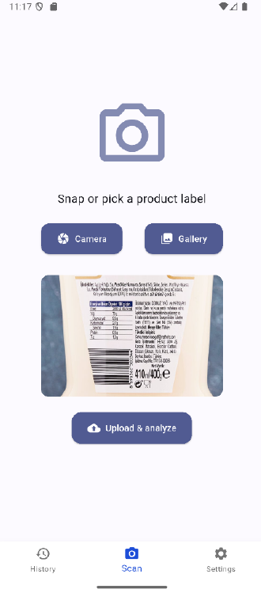
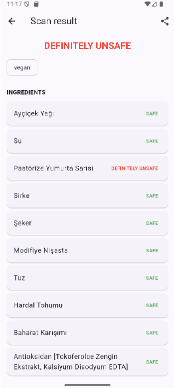
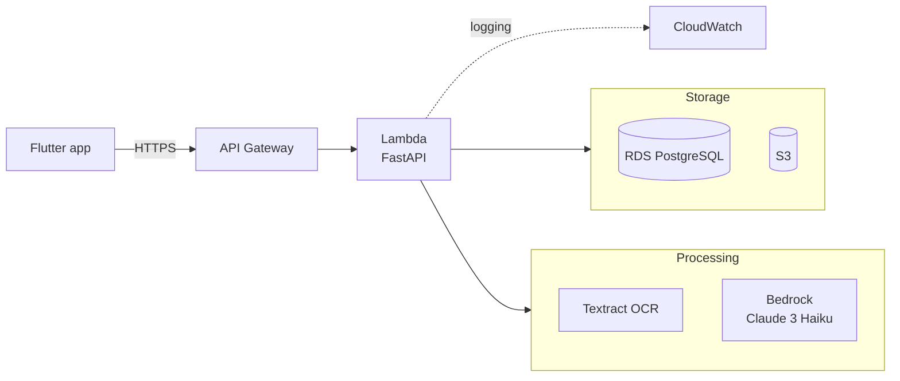

# Ingredient Checker

A full-stack mobile app that tells people with strict dietary restrictions whether a packaged food is safe for them, straight from a photo of its ingredient list. Built as my graduation project in Computer Engineering at Yeditepe University (2025).

It supports three restrictions (**celiac disease**, **nut allergy** and **veganism**) and labels every ingredient as *safe*, *maybe unsafe* or *definitely unsafe*. Every ingredient gets classified individually, which then adds up to a final verdict.

Examples:
- Wheat is *definitely unsafe* for people with celiac disease, as it contains gluten.
- Broccoli is *safe* for people with nut allergies as broccoli doesn't have nuts (unless you hate broccoli, in which case, you *are* nuts).
- Caramel gets a *maybe unsafe* verdict for vegans, as it may be sourced from either heated sugars (*safe*) or butter and cream (*definitely unsafe*).

## User interface

  
  

## How it works

1. The user photographs an ingredient label (or picks one from the gallery).
2. To have enhanced readability in pictures regardless of lighting conditions and camera angles, the backend applies image preprocessing, then stores it in S3.
3. AWS Textract runs OCR on four rotations of the image (0°, 90°, 180°, 270°) and keeps the most complete result.
4. A regex extractor isolates the ingredient list and trace-allergen statements.
5. The ingredients are classified against the user's restrictions based on their choice of classification method.
6. Results are stored for the user's scan history and returned to the app.

## Classification approaches

| Approach | Notes |
|---|---|
| Rule-based fuzzy engine | Fast, deterministic and explainable but limited to its keyword list |
| Claude 3 Haiku via Bedrock | Best recall on unfamiliar ingredients, also restores Turkish diacritics lost by OCR |
| TF-IDF + SVM | Struggled with heavy class imbalance |
| Fine-tuned mBERT | Better minority-class recall than TF-IDF, overfit on scarce data |

## Numerical results

- **LLM classifier:** F1 of 0.78–0.82 across the three diets
- **Rule engine:** weighted F1 of 0.98 for celiac and nut allergy, inflated by the safe majority class
- **Ingredient extraction:** 80% exact match with the regex extractor
- **Latency (warm):** ~3 s for rule-based scans, ~6 s for LLM scans, under 1 s for history

## Tech stack

**Backend:** Python FastAPI (Important Libraries: Mangum, Pydantic, SQLAlchemy, asyncpg, Boto3, Pillow, bcrypt, PyJWT)

**AWS Offerings:** Lambda, API Gateway, Textract, Bedrock, S3, RDS, CloudWatch, IAM, VPC

**Frontend:** Flutter (Android)

## Status
This project is no longer deployed due to infra costs, so I don't recommend deploying it just to try it out.